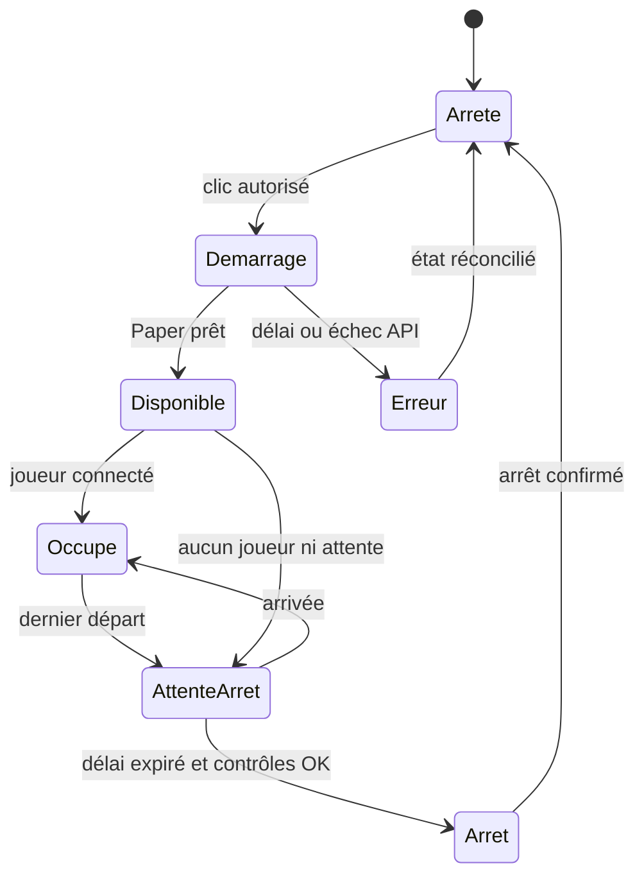

# Build à la demande — spécification, non implémentée

Demande : cliquer sur Build dans la boussole démarre le serveur s'il est arrêté, puis connecte le joueur une fois Paper prêt. Build s'arrête automatiquement lorsqu'il est vide. Aucun composant décrit ici n'est encore développé ou déployé.

## Répartition proposée

- Boussole Lobby : conserve la permission `lodgelobby.server.build`, demande le transfert à un coordinateur sur Velocity ; aucun token Pterodactyl dans le plugin Lobby.
- Coordinateur Velocity : connaît les connexions/transferts en attente et reste actif lorsque Build est arrêté. Déclenche un démarrage via l'API Client Pterodactyl, attend la disponibilité protocolaire Minecraft avant transfert.
- API Pterodactyl : compte technique et clé Client limités au seul Build et à son alimentation/lecture des ressources ; pas de clé Application administrateur. Secret externe, jamais en Git ou dans les logs.

## Machine d'états

Valeurs initiales proposées et ajustables : délai vide 10 minutes, délai de démarrage 120 secondes, contrôles d'état toutes les 5 secondes, timeout HTTP court et retries bornés. Ces valeurs ne sont pas des paramètres installés.

## Comportement et protections requis

1. Vérifier les permissions à la demande puis avant transfert. Dédupliquer les demandes simultanées : un démarrage, plusieurs joueurs en attente.
2. Message « Build démarre… » ; annuler l'attente si déconnexion ou changement de destination volontaire. Ne jamais téléporter tardivement un joueur qui a abandonné.
3. Toutes les requêtes HTTP sont asynchrones ; pas de blocage du thread serveur/proxy. Replanifier les interactions avec les joueurs sur les API appropriées.
4. Ne pas confondre conteneur running et Paper prêt. Ne pas arrêter un serveur seulement parce que l'API répond mal ou qu'un ping échoue ; échouer sans arrêt destructeur.
5. Lire la population à partir des connexions proxy et confirmer l'état côté serveur/API pertinente. Réinitialiser l'attente à chaque arrivée ; protéger la transition arrêt/transfert contre les courses. Ne pas arrêter s'il existe une demande en cours.
6. Respecter installation, suspension, restauration, sauvegardes et maintenance ; débrayage manuel pour travail console et sauvegardes nocturnes. Définir explicitement comment détecter un backup actif avant implémentation.
7. Arrêt gracieux par signal stop, jamais kill. Confirmer l'arrêt avant d'accepter un nouveau démarrage, ou mettre la demande en attente jusqu'à la fin de l'arrêt.
8. Réconcilier l'état au redémarrage du proxy ; ne pas dépendre uniquement d'un ancien compteur local. Conserver une commande d'administration permettant de désactiver l'automatisme.
9. Compatibilité schedule : un Build arrêté peut ignorer/échouer les commandes `save-*`. Adapter la sauvegarde pour couvrir aussi l'état arrêté ; ne pas allumer puis arrêter pendant une archive sans coordination.

## Tests nécessaires

Build déjà ouvert ; démarrage à froid ; deux clics simultanés ; erreur API ; permission refusée ; déconnexion pendant démarrage ; dernier départ puis retour avant délai ; clic pendant arrêt ; proxy redémarré ; sauvegarde en cours ; arrêt propre confirmé. Tester sans impacter Survival.

## Éléments requis pour coder et déployer

Sources courantes de la boussole/connexion Lobby et du plugin Velocity, version des API/POM, identifiant Pterodactyl de Build (pas l'UUID inventé), méthode d'accès au panel depuis le proxy et stockage externe du secret. Les sources privées LodgeCraft ne sont pas accessibles dans la session au moment de cette révision. L'intégration doit être faite dans le dépôt de plugins, distinct du dépôt d'infrastructure.
