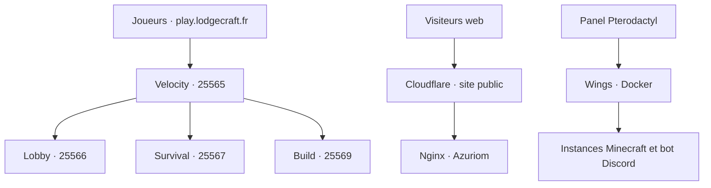

# Architecture réseau — 18 octobre 2026



## Hôte et adressage interne

VPS OVH `vps-05a8e0df`, Ubuntu 24.04.5, noyau 6.8.0-147 selon le bilan du 18 octobre. Réseau Docker `pterodactyl_nw`, plage historique `172.18.0.0/16`. L'hôte MariaDB est accessible depuis les conteneurs autorisés via `172.18.0.1:3306`.

Velocity utilise le DNS des conteneurs Pterodactyl. Les UUID historiques connus sont : Lobby `f6c3898e-5ad8-46c0-9492-75f9d26428da`, Survival `db5a93b3-2dfe-4a41-b9b1-a5856a6eaf86`. UUID Build non documenté ; ne pas l'inventer ni utiliser localhost dans le conteneur proxy pour joindre un autre conteneur.

## Authentification Minecraft

Velocity : authentification premium et forwarding `modern`. Les trois Paper : Velocity `enabled=true`, `online-mode=true` dans la section de forwarding Paper, mais `online-mode=false` dans `server.properties`. Le secret est identique et a été vérifié par empreintes sans être affiché. Ces deux réglages online-mode concernent des niveaux différents et ne se contredisent pas.

Les backends ne doivent pas accepter les connexions Internet directes. Voir [pare-feu](../security/FIREWALL.md).

## Web et Cloudflare

`lodgecraft.fr` et `www.lodgecraft.fr` ont été passés en proxy Cloudflare. Une règle Managed Challenge a été testée sur l'accueil :

```text
(http.host in {"lodgecraft.fr" "www.lodgecraft.fr"}
 and http.request.uri.path eq "/"
 and http.request.method eq "GET"
 and not cf.client.bot)
```

Elle ne concerne pas `/packs/`, les API, les autres pages, les POST ni `play`, `panel`, `node`, `discord`. Elle ne protège donc pas tous les accès web. Les autres entrées restent DNS uniquement selon la configuration demandée. Le trafic Minecraft ne doit pas être passé au proxy HTTP Cloudflare standard.

Les resourcepacks sont servis via `/packs/`. L'IP d'origine reste identifiable via les autres services : ne pas promettre qu'elle est cachée ou que l'accès web direct est bloqué sans vérification spécifique.

## Évolutions

Build à la demande : demandé, non implémenté. Minage/Event/Dev : projets, pas des serveurs actuellement confirmés. Voir [spécification Build](BUILD_ON_DEMAND.md).
